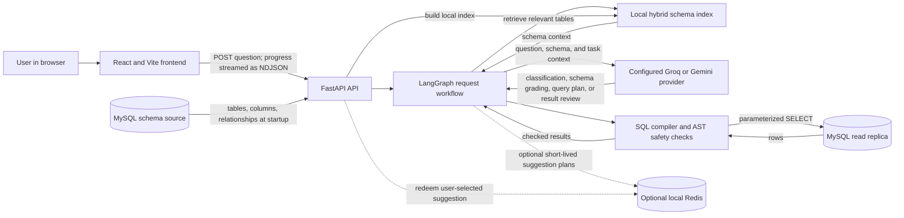

# Ask Your Data

Ask Your Data lets a user ask questions about business data in everyday language and see the matching database results in a web chat.

> **Project status:** This is a working project, not yet a production-ready enterprise service. Review [Security](#security) and [Known limitations](#known-limitations) before connecting real or sensitive data.

## Overview

- **What it does:** turns a natural-language question into a structured query plan, checks the plan, runs a read-only query, and returns results in a React interface.
- **Who it is for:** business users and analysts who need answers from a supported MySQL database without writing SQL.
- **What it does not do:** it is not a general-purpose chatbot, does not change database records, and cannot reliably answer questions about data that is absent from the connected schema.

## Architecture

The diagram is based on the application source. [Open the interactive architecture diagram](./.archify/architecture-ask-your-data-20261012-195903/ask-your-data.html).



### Request flow

1. The browser sends a question to the FastAPI streaming endpoint.
2. The workflow classifies the question, checks the in-memory answer cache, and gathers relevant schema and business rules.
3. A configured AI provider produces structured query information; the application compiles it into parameterized SQL.
4. Safety checks validate the generated SQL before it is sent to the read-only MySQL replica.
5. A result grader checks the returned data, then the API streams the answer and results to the browser.
6. Optional follow-up suggestion plans use Redis when it is available. Redis is not the semantic answer cache.

Some requests stop earlier—for example, if they are casual chat, are unsupported by the schema, or fail validation.

### Why these choices

| Choice | Why it is used |
|---|---|
| React and Vite | Provide a responsive browser interface with a local development server and production build. |
| FastAPI | Exposes validated chat endpoints and streams pipeline progress to the frontend. |
| LangGraph | Makes the multi-step agent workflow and its branches explicit. |
| Hybrid schema retrieval | Combines keyword matching with local semantic embeddings to find relevant tables without sending the entire schema for every question. |
| Structured query plan and SQL AST validation | Keeps the model from directly executing raw SQL and allows the application to reject unsupported or unsafe query structures. |
| MySQL read replica and parameterized values | Separate query execution from the primary database and keep user-provided values out of SQL syntax. The replica account still must be configured with least privilege. |
| Optional Redis | Shares short-lived, one-time suggestion plans where a shared store is useful; normal chat can fall back to the regular query path. |
| Configurable Groq/Gemini clients | Lets each agent role select a supported provider and model through environment configuration. |

## Getting started

The application needs Node.js, Python, a MySQL database with the expected schema/data, and AI provider credentials. Redis is optional for the suggestion fast path.

### 1. Get the repository

```powershell
git clone https://github.com/AlbinRajesh/Text---To---Sql.git
cd Text---To---Sql
```

### 2. Configure the backend

Use Python **TODO: confirm and pin the supported Python version**. From the repository root:

```powershell
cd backend
python -m venv .venv
.\.venv\Scripts\Activate.ps1
python -m pip install --upgrade pip
pip install -r requirements.txt
Copy-Item .env.example .env
```

Edit `backend/.env` and replace every required `TODO_...` value. Provision the MySQL source and read replica and load the project-compatible schema/data:

- MySQL schema/data setup instructions: **TODO**
- Read-only replica host and database: **TODO**
- AI provider accounts/models for each configured role: **TODO**

The first startup may download the local schema embedding model. It needs network access and disk space; the default model is approximately 130 MB.

### 3. Start the backend

From the `backend` directory, with the virtual environment active:

```powershell
python -m uvicorn app.main:app --reload --host 127.0.0.1 --port 8000
```

The backend initializes database connections, reads schema metadata, builds the local schema index, and attempts to connect to Redis. Check `http://127.0.0.1:8000/api/health` for backend, database, and optional suggestion-store status.

### 4. Start the frontend

In a second terminal, from the repository root:

```powershell
cd frontend
npm ci
Copy-Item .env.example .env.local
npm run dev
```

Open the local URL printed by Vite (normally `http://localhost:5173`). The frontend API URL defaults to `http://localhost:8000`.

### Optional: run Redis locally

In a terminal at the repository root:

```powershell
docker compose up -d redis
```

If Redis is unavailable, normal questions continue to use the standard workflow; the suggestion fast path is unavailable. Stop the local Redis container with `docker compose down`.

### Production setup checklist

- Set the production frontend origin in the backend CORS configuration (**currently localhost-only; TODO: make configurable**).
- Configure HTTPS, authentication/authorization, rate limits, monitoring, and secret management (**TODO**).
- Use dedicated least-privilege MySQL accounts and verify grants on the actual hosts (**TODO**).
- Review the chosen AI providers' data-processing and retention terms for your data classification (**TODO**).
- Test this setup on a clean teammate machine and record the supported OS/runtime versions (**TODO**).

## Configuration

Never commit `.env` files or real API keys. Values beginning with `TODO_` are placeholders; replace them before starting the backend.

### Backend (`backend/.env`)

| Variable | Required | Purpose / default |
|---|---:|---|
| `MYSQL_HOST` | Yes | MySQL schema/administrative connection host. |
| `MYSQL_USER` | Yes | User for the primary/schema connection; use least privilege. |
| `MYSQL_PASSWORD` | No | Password for that user; empty by code default. |
| `MYSQL_DATABASE` | Yes | Database/schema to inspect. |
| `MYSQL_PORT` | No | Primary port; default `3306`. |
| `MYSQL_POOL_MIN_SIZE` | No | Primary pool minimum; default `1`. |
| `MYSQL_POOL_MAX_SIZE` | No | Primary pool maximum; default `10`. |
| `MYSQL_READ_REPLICA_HOST` | Yes | Host used for query execution. |
| `MYSQL_READ_ONLY_USER` | Yes | Dedicated read-only execution user. Grant only the access needed to read approved tables. |
| `MYSQL_READ_ONLY_PASSWORD` | No | Read-only user's password; empty by code default. |
| `MYSQL_READ_REPLICA_DATABASE` | Yes | Database/schema on the query host. |
| `MYSQL_READ_REPLICA_PORT` | No | Query-host port; default `3306`. |
| `MYSQL_READ_POOL_MIN_SIZE` | No | Query pool minimum; default `1`. |
| `MYSQL_READ_POOL_MAX_SIZE` | No | Query pool maximum; default `10`. |
| `CLASSIFIER_PROVIDER`, `SCHEMA_GRADER_PROVIDER`, `QUERY_GENERATOR_PROVIDER`, `RESULT_GRADER_PROVIDER` | No | Provider for each role; defaults to `groq`. Supported providers are `groq` and `gemini`. |
| `CLASSIFIER_MODEL`, `SCHEMA_GRADER_MODEL`, `QUERY_GENERATOR_MODEL`, `RESULT_GRADER_MODEL` | Yes | Model name for each role. Choose a model supported by that role's configured provider. |
| `CLASSIFIER_API_KEY`, `SCHEMA_GRADER_API_KEY`, `QUERY_GENERATOR_API_KEY`, `RESULT_GRADER_API_KEY` | Yes | API key for each role's configured provider. Do not put actual keys in this README or source control. |
| `SUGGESTION_REDIS_URL` | No | Redis URL; default `redis://localhost:6379/0`. If unreachable, suggestion redemption is disabled. |
| `APP_ENV` | No | `development` allows clarification notes to use process-local memory if Redis is unavailable; `production` (default) requires Redis for clarification notes. |
| `PENDING_CLARIFICATION_TTL_SECONDS` | No | Clarification-note expiry in seconds; default `600` (10 minutes). |
| `SCHEMA_EMBEDDING_MODEL` | No | Local embedding model; default `BAAI/bge-small-en-v1.5`. |
| `SCHEMA_EMBEDDING_CACHE_DIR` | No | Local model cache directory; default `models_cache`. |
| `USE_QUESTION_REWRITE` | No | Enables classifier question rewriting; default `true`. |
| `MAX_RETRIES` | No | LLM retry limit; default `3`. |
| `LLM_BASE_BACKOFF_SECONDS` | No | Base retry backoff; default `1.0`. |
| `LLM_TIMEOUT_SECONDS` | No | Default LLM timeout; default `30.0`. |
| `LLM_MAX_RETRY_AFTER_SECONDS` | No | Maximum provider-requested retry wait; default `60`. |
| `LLM_RATE_LIMIT_FLOOR_SECONDS` | No | Minimum wait when a rate-limit response has no usable retry header; default `10`. |
| `LOG_RETRY_PROMPT` | No | Enables logging retry prompts when set to `1`, `true`, or `yes`; leave disabled for privacy. |
| `ESCALATION_AUDIT_LOG_PATH` | No | Escalation audit log path; default `logs/escalations.jsonl`. Restrict access and define retention. |

Each LLM role needs its own `*_MODEL` and `*_API_KEY`. The provider defaults to Groq unless its `*_PROVIDER` is set. Example placeholder settings are in `backend/.env.example`.

### Helper-only MongoDB settings

These are read by the standalone [MongoDB helper](./backend/app/db/mongo_client.py), not by the normal MySQL application startup. They are not needed to run the documented app. If you use the helper, uncomment and fill in the placeholders at the end of [`backend/.env.example`](./backend/.env.example):

| Variable | Required if helper is used | Purpose |
|---|---:|---|
| `MONGO_URI` | Yes | MongoDB connection string. |
| `MONGO_DB_NAME` | Yes | MongoDB database name. |

### Frontend (`frontend/.env.local`)

| Variable | Required | Purpose / default |
|---|---:|---|
| `VITE_API_URL` | No | Backend base URL; default `http://localhost:8000`. |
| `VITE_MOCK` | No | Set to `true` only for frontend mock mode; default `false`. Never place secrets in `VITE_*` variables because they are exposed to browser code. |

## Security

This section describes current code safeguards; it is **not** a claim of a completed security audit or production certification.

- **Read-only query path:** generated queries execute through a separate MySQL read-replica pool using `MYSQL_READ_ONLY_USER`. Configure that database account with `SELECT`-only privileges for approved tables. Application code cannot compensate for overly broad database grants.
- **SQL validation:** the model returns structured query data rather than SQL for direct execution. The application compiles parameterized values, parses the SQL as MySQL, accepts a single `SELECT`, rejects write/DDL statements, validates table/column usage, applies result limits, and restricts sensitive/personal fields.
- **External AI providers:** configured Groq/Gemini providers receive prompts for the roles that run. Depending on the request, prompt content includes the user's question, relevant schema/business context, a generated query plan or SQL, and (for result grading) column names plus up to 20 result rows. Those rows may contain business data. Provider processing, retention, and training policies are **TODO: verify with your chosen provider and contract**. Do not send sensitive production data until approved.
- **Local embeddings:** the schema retrieval embedding model runs locally; the application does send question/schema context to configured LLM providers separately.
- **Credentials:** keep API keys and database passwords in an untracked local `.env` or an approved secrets manager. Use distinct credentials by environment and rotate exposed credentials.
- **Authentication and tenant isolation:** the local app currently has no user authentication or authorization layer. The semantic answer cache is in-memory and global to the process; the code itself warns that tenant/user identity must be part of the cache key where users have different access. Do not expose it to multiple users or tenants with different data permissions until access control and tenant-scoped caching are implemented and tested.
- **Logs:** retry-prompt logging is optional and should remain off for sensitive data. Restrict escalation-log access and define retention before deployment.
- **Deployment controls:** HTTPS, identity, production CORS origins, rate limiting, provider privacy review, alerting, backup/restore, and incident response are **TODO**.

## Testing

From `backend`, activate the virtual environment and run:

```powershell
python -m pytest app/tests
```

Some tests require a configured MySQL database, network access, or provider credentials. **TODO: mark unit vs. integration tests and document a fully offline test command.**

### Golden benchmark

The master benchmark currently loads `golden_benchmark_catalog_3.py`, containing 40 cases (26–65): classifier/routing checks, SQL comparisons and business queries, multi-turn follow-ups, data-quality checks, and safe refusals. Run it from `backend`:

```powershell
python -m app.tests.master_golden_benchmark
```

Run selected cases to save time/provider quota:

```powershell
python -m app.tests.master_golden_benchmark --cases 26,32,38,48 --delay 2
```

Classifier cases score intent, complexity, and expected graph route. Conversation cases run their turns sequentially under a shared conversation ID (or separate IDs for isolation checks); cases expecting clarification require an explicit clarification marker. SQL cases use canonical AST or result-set comparison. Conversation-memory cases are expected to expose missing behavior until context memory and clarification support are implemented. The runner writes an accuracy CSV and a companion `*_latency.csv` under `backend/app/tests`. The latency file separates measured stages, provider calls/retries, database timing, setup time, and intentional pacing; it does **not** measure the complete browser/frontend request path. Keep generated run reports local unless a specific report has been reviewed for sensitive data and intentionally selected for publication.

### Latest recorded results

- **Previous full 25-case run against the earlier catalog:** `daily_golden_benchmark_20261012_133326.csv` — **24/25 passed**. Case 31 failed at safety validation because a grouped-query ordering was rejected.
- **Previous targeted run against the earlier catalog:** `daily_golden_benchmark_20261012_141736.csv` — **4/4 selected cases passed**. This was not a rerun of the full suite.
- Those reports predate catalog 3 and do not validate its 40 cases or multi-turn behavior. Provider/model behavior and underlying database contents can change. **TODO: run catalog 3 and record the date, revision, configuration, and result before release.**

## Known limitations

- The recorded full benchmark has a known Case 31 failure; the later four-case run does not prove that the complete suite passes.
- AI output can vary across runs, and provider rate limits or outages can affect both latency and results.
- The benchmark measures backend pipeline work, not end-to-end browser rendering, network latency, or all frontend behavior.
- The semantic cache is local to a process, resets on restart, and is not safe as a cross-tenant shared cache without user/tenant scoping.
- There is no authentication/authorization layer in the local application setup.
- The app depends on the live MySQL schema and data. Database provisioning/seed instructions and a portable sample dataset are **TODO**.
- Production deployment, privacy/retention approval for providers, role grants, monitoring, and supported runtime versions are **TODO**.

## License and ownership

License: **TODO: add the project's license and ownership details.**
