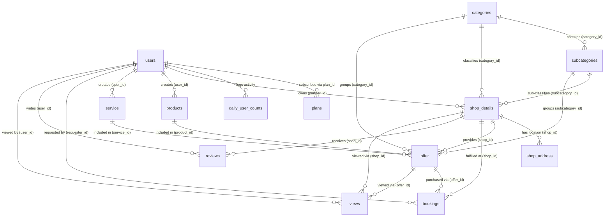

# Database Schema Documentation

This document outlines the structure, purpose, and relational connections for the core tables within the Coupown database.

## Table Summaries

*   **`bookings`**: Records customer reservations, appointments, or purchases of offers from shops, tracking the date, payment amounts, and location details.
*   **`categories`**: Defines the broad, top-level classifications (like "Food & Dining" or "Automobiles") used to group shops and offers.
*   **`editable_offers_view`**: A virtual table (view) that neatly combines offer, shop, and service details into one place to make it easier for admins or partners to manage their deals.
*   **`offer`**: Stores all the promotional deals, discounts, and coupons created by shops, including their pricing, start/end dates, and redemption limits.
*   **`offer_items_view`**: A virtual table (view) that provides a quick, joined snapshot linking a promotional offer directly to its specific product and shop name.
*   **`plans`**: Defines the different subscription tiers (including pricing, billing intervals, and feature limits) that users or shop partners can purchase.
*   **`products`**: Acts as a simple catalog storing the names of products or items associated with a specific user or shop.
*   **`reviews`**: Stores the text feedback and numerical star ratings that users submit for different shops.
*   **`service`**: Maintains a simple list of specific services (like repairs, catering, or transport) created or offered by users.
*   **`shop_address`**: Holds the physical location details, city, and GPS map coordinates for shops, allowing them to have multiple addresses with one marked as the default.
*   **`shop_details`**: Contains the primary profile information for businesses, including their name, contact info, category links, and legal vehicle documents for transport/service providers.
*   **`subcategories`**: Defines the narrower, more specific groups (like "Juice" or "Furniture") that fall under your main categories.
*   **`users`**: Manages all account profiles (for customers, shop partners, and admins), handling logins, contact information, and tracking active subscriptions.
*   **`views`**: Logs every time a user looks at a specific offer or shop, allowing you to track customer engagement and popularity metrics.

---

## How Your Tables Connect

Your database is built around a few central entities: **Users**, **Shops**, and **Categories**, with other tables branching off them to handle commerce and interactions.

## Location Semantics

The meaning of a city depends on which entity the question describes:

* **Shop location:** use `shop_address.city` through `shop_address.shop_id` to `shop_details.id`. For a shop's representative location, filter `shop_address.is_default = 1`.
* **Booking/store city for business metrics:** use the booked shop's controlled default-address city, `shop_address.city`, for regional/store metrics and booking counts or aggregates grouped/filtered by city. Join bookings through the verified shop relationship and require `shop_address.is_default = 1`.
* **Customer-entered booking city:** `bookings.city` is unvalidated free text and may contain spelling errors or casing variants. It is non-groupable and must not be used in `WHERE` filters or `GROUP BY`. If a question explicitly asks to display the city typed on the booking/customer record, it may be selected as raw descriptive text only. For booking/store city filters and aggregates, use the booked shop's default-address city described above. Do not add query-level `LOWER`/`TRIM` wrappers to compensate for inconsistent values.
* **Multiple addresses:** use all matching addresses only when the question explicitly asks for all/any addresses; otherwise the default-address condition avoids duplicating shop and booking rows.

For new or corrected data, use application-layer controlled city selection (such as a validated dropdown) and normalize existing records through a data-quality process; keep generated SQL predicates directly on the canonical city column.

### 1. Users & Access
*   **`users`**: The core table for all accounts.
*   **`plans`**: Connects to `users` (via `plan_id`) to define the user's active subscription tier.
*   **`daily_user_counts`**: Connects to `users` (via `user_id`) to log activity.

### 2. Business Profiles
*   **`shop_details`**: The central hub for a business. Connects to `users` (via `partner_id` linking to the owner).
*   **`shop_address`**: Connects to `shop_details` (via `shop_id`) to store physical locations.

### 3. Categorization
*   **`categories`**: Top-level groupings. Connects to `shop_details` and `offer`.
*   **`subcategories`**: Connects to `categories` (via a strict foreign key on `category_id`). Also connects to `shop_details` and `offer` for narrower classification.

### 4. Commerce & Offerings
*   **`products` & `service`**: Connect to `users` (via `user_id`) to list items/services being sold.
*   **`offer`**: Connects to `shop_details` (`shop_id`), `categories`, `subcategories`, and specific `products` or `service`.
*   **`editable_offers_view` & `offer_items_view`**: Virtual tables pulling combined data from the above tables.

### 5. Customer Interactions
*   **`bookings`**: Connects to `offer` (what was bought, `offer_id`), `shop_details` (where, `shop_id`), and `users` (who, `requester_id`).
*   **`reviews`**: Connects to `shop_details` (`shop_id`) and `users` (`user_id`).
*   **`views`**: Connects to `offer` (`offer_id`), `shop_details` (`shop_id`), and `users` (`user_id`).

---

## Entity-Relationship Visualization

*(If you view this Markdown file in a supported editor, the block below will render as a visual flowchart.)*

